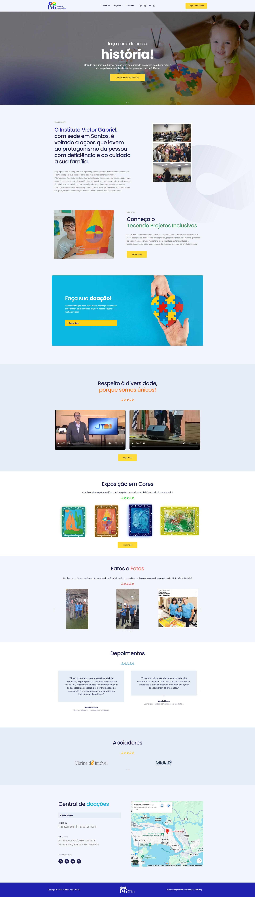
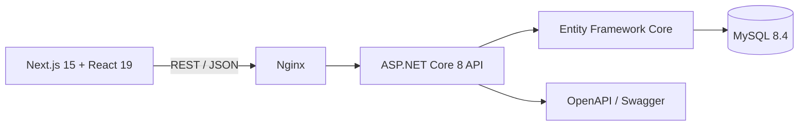

<div align="center">

# VoluntaMais

### Volunteer opportunity and engagement platform

Full Stack application that connects institutions, opportunities and volunteers through a typed web interface and a production-oriented .NET API.

[](https://nextjs.org/)
[](https://learn.microsoft.com/aspnet/core/)
[](https://www.mysql.com/)
[](https://www.docker.com/)

[Live application](https://tcc-voluntariado.vercel.app) · [Architecture](#architecture) · [Run locally](#run-locally) · [API](#api)

</div>

---



## Product overview

VoluntaMais centralizes the volunteer journey: institutions publish opportunities, people register skills and interests, and coordinators manage applications, participation and feedback. The repository demonstrates product delivery across frontend, backend, data modeling and deployment infrastructure.

### Main workflows

- register and manage volunteers, institutions and user accounts;
- publish and browse categorized volunteer opportunities;
- apply to opportunities and approve or reject applications;
- associate volunteer skills with suitable work;
- manage feedback and notifications;
- monitor the platform through dashboard views;
- expose health and Swagger endpoints for operational use.

## Architecture



| Layer | Implementation |
| --- | --- |
| Web | Next.js App Router, React 19, TypeScript and Axios |
| API | ASP.NET Core controllers, DTOs and enum serialization |
| Data | EF Core with Pomelo MySQL provider and optional seed |
| Operations | Docker Compose, Nginx, health endpoint and environment-based configuration |
| Security boundary | Explicit CORS origins in production and secrets provided through environment variables |

## Repository structure

```text
TCC-Voluntariado/
├── frontend/          # Next.js application and product flows
├── backend/           # ASP.NET Core API, models, DTOs and data access
├── nginx/             # Reverse-proxy configuration
├── docker-compose.yml # MySQL, API, frontend and Nginx topology
└── .env.example       # Safe configuration reference
```

## API

The API contains controllers for authentication, volunteers, institutions, opportunities, applications, skills, categories, notifications and feedback.

Development endpoints:

- API: `http://localhost:5000`
- health: `http://localhost:5000/health`
- Swagger: `http://localhost:5000/swagger`

Swagger is disabled by default in production and can be enabled explicitly through configuration.

## Run locally

### Docker Compose

Requirements: Docker Engine and Docker Compose.

```bash
cp .env.example .env
docker compose up --build
```

Set the database passwords, public frontend URL and backend URL in `.env` before starting the stack. Do not commit that file.

### Development mode

Backend requirements: .NET 8 SDK and MySQL.

```bash
cd backend
dotnet restore
dotnet run
```

Frontend requirements: Node.js 20+.

```bash
cd frontend
cp .env.example .env.local
npm install
npm run dev
```

The frontend uses `NEXT_PUBLIC_API_URL` to locate the API.

## Configuration

| Variable | Purpose |
| --- | --- |
| `MYSQL_DATABASE` | application database |
| `MYSQL_USER` / `MYSQL_PASSWORD` | application database credentials |
| `MYSQL_ROOT_PASSWORD` | MySQL administrative password |
| `FRONTEND_PUBLIC_URL` | allowed CORS origin |
| `BACKEND_PUBLIC_URL` | API URL embedded in the frontend build |
| `SEED_DATABASE` | enables the demonstration seed when explicitly set |
| `SWAGGER_ENABLED` | controls production Swagger exposure |

## Engineering decisions

- CORS accepts only configured production origins.
- Database seeding is opt-in outside local development.
- Forwarded headers support reverse-proxy deployment.
- The health endpoint provides a simple orchestration check.
- Docker services share a private network and MySQL has a health check.

## Academic context

This project was developed as a final course project in Analysis and Systems Development at IFSP. Repository data is intended for demonstration and academic use.
